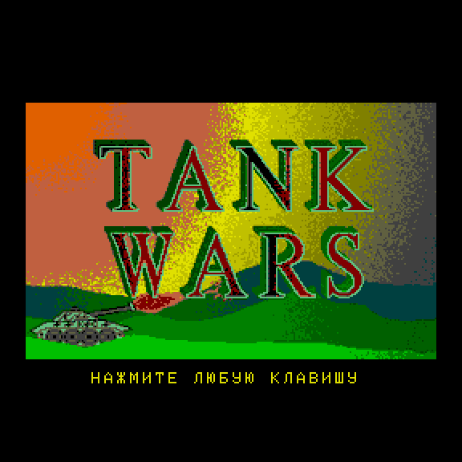
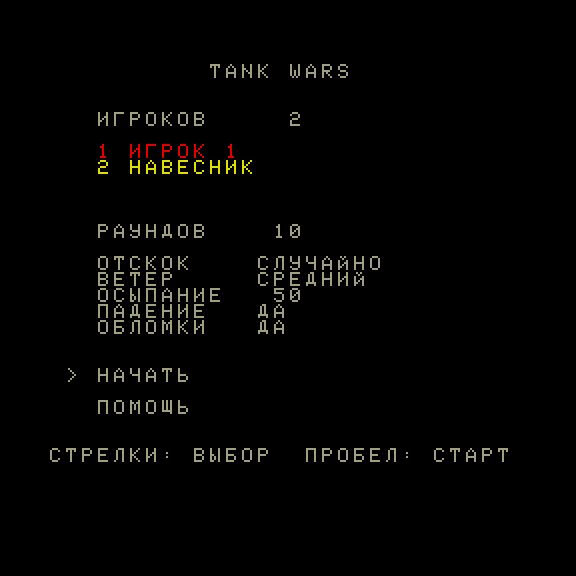
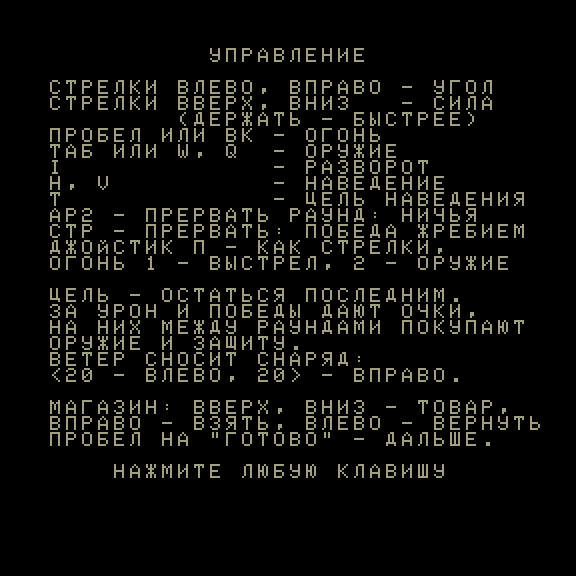
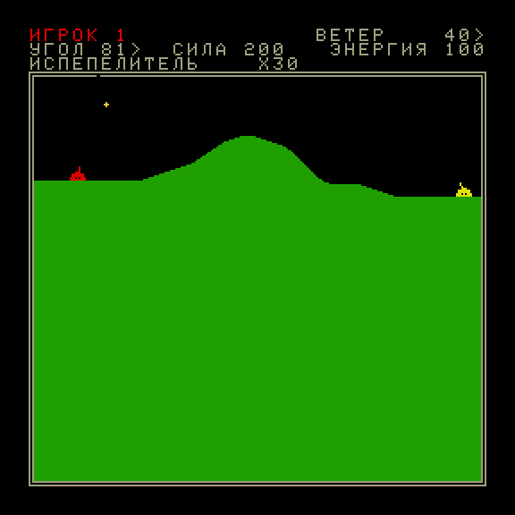

# Tank Wars для Вектора-06Ц

Порт артиллерийской игры **Tank Wars 2.5** (Кенни Морс, 1990, DOS, Turbo Pascal 6) на Вектор-06Ц (КР580ВМ80А,
3 МГц, 64 КБ). Исходников оригинала нет: поведение восстановлено дизассемблированием `BOMB.EXE`, перенесено в
эталон на JavaScript, сверено с настоящей игрой, и уже с эталона написан порт на ассемблере 8080.

Инструкция для игроков — [docs/MANUAL_RU.md](docs/MANUAL_RU.md).

| Заставка | Настройка матча |
|---|---|
|  |  |

| Помощь | Ход: снаряд в полёте |
|---|---|
|  |  |

## Готовый образ

[`rom/tankwars.rom`](rom/tankwars.rom) — игра целиком: заставка в 16 цветах и сжатая игра, около 29 КБ, грузится с
0100h. Подходит для MiSTer (ядро Вектора-06Ц), эмуляторов и Вектора Турбо+: в CP/M — под именем `TANKWARS.COM`,
команда `TANKWARS -V T3`. Пересобирается командой `sh v06c/build.sh`.

Игра на русском; английской сборки нет (тексты и имена компьютеров переведены в эталоне и порте, а тип компьютера
порт узнаёт по буквам имени). Читов нет.

## Управление

Клавиатура: стрелки — угол и сила, пробел или ВК — огонь, ТАБ/W и Q — оружие, I — разворот ствола, H/V/T —
наведение, АР2 и СТР — прервать раунд. **Джойстик «П»** (ВВ55 № 2, порт 06h, любой из двух) заменяет стрелки
везде — на ходу, в настройке и в магазине; огонь 1 — выстрел, огонь 2 — следующее оружие; огнём же закрывается
заставка. Значение порта в покое загрузчик замеряет до заставки и передаёт игре, так что постоянный мусор на шине
нажатием не считается. Порт 0Eh (джойстик «С») не читается. Подробно — в [инструкции](docs/MANUAL_RU.md).

## Как устроен проект

```
оригинал (orig/)  ──дизассемблирование──▶  спецификации (docs/spec/)  ──▶  эталон на JS (web/)
                                                                              │ сверка с оригиналом: tests/fixtures
                                                                              ▼
                                                              порт на 8080 (v06c/)  ── сверка с эталоном ход в ход
```

| Каталог | Что в нём |
|---|---|
| `orig/` | *(в репозитории нет)* оригинальная игра: `BOMB.EXE`, `BOMB.OVR`, картинки, документация — см. «Оригинал» ниже |
| `re/` | разбор оригинала: заметки `NOTES.md`, карта оверлеев, имена подпрограмм; сами файлы игры и выгрузка Ghidra в репозиторий не входят |
| `scripts/` | модели на Python и пробы: исполнение кусков оригинала и снятие эталонных случаев |
| `docs/spec/` | спецификации по разделам: баллистика, рельеф, взрывы, оружие, ИИ, матч; `v06c*.md` — версия для Вектора |
| `web/` | **эталон на JS** и страница с игрой |
| `tests/fixtures/` | эталонные случаи, снятые с настоящей игры, и золотые матчи профиля Вектора |
| `v06c/` | **порт**: исходники (`src/`), инструменты (`tools/`), тесты (`test/`), сборка (`build.sh`) |
| `tools/bin/` | ассемблер `sjasmplus` 1.24.0 и упаковщик `zx0` 2.2 (сборки для macOS arm64) |
| `docs/` | план порта, доска задач, инструкция, памятка для следующей сессии (`NEXT_SESSION.md`) |

## Эталон на JS (`web/`)

`web/tankwars.js` — вся логика игры одним модулем без зависимостей (1,7 тыс. строк): генератор случайных чисел
Turbo Pascal, вещественные Real48, рельеф, полёт снаряда, ветер, всё оружие, осыпание и падение, семь вариантов
гибели танка, семь компьютерных игроков, матч, магазин. `web/fixmath.js` — целая арифметика Q16.16 для Вектора.

У эталона два профиля:

- **`PROFILE_DOS`** повторяет оригинал: экран 320×200, вещественная арифметика. Он сверен с настоящей игрой —
  910 эталонных случаев и три матча компьютеров целиком (338 ходов), записи игроков и состояние генератора
  случайных чисел совпадают на каждом событии.
- **`PROFILE_V06C`** — та же логика в размерах Вектора: 256×256, 8 цветов, до 4 игроков, целые числа, русские
  тексты. С оригиналом он уже не сравнивается (поле другое) — он сам служит эталоном для порта. Все отличия от
  оригинала перечислены в [docs/spec/v06c.md](docs/spec/v06c.md).

Правило проекта: любая правка логики делается сначала в эталоне, потом в порте, и сверяется.

```sh
node web/test/run_fixtures.mjs      # профиль DOS против случаев настоящей игры: 910/910
node web/test/replay_match.mjs      # повтор трёх матчей оригинала ход в ход
node web/test/v06c_selfplay.mjs     # профиль Вектора: 12 матчей, инварианты, золотые хеши (--update — переснять)
node web/test/page_smoke.mjs        # страница без браузера
python3 -m http.server -d web       # страница с игрой: http://localhost:8000
```

Подробнее — [web/README.md](web/README.md).

## Сборка порта

Нужны: `sh`, Node.js (проверено на 26.4), Python 3 (3.14) с `numpy` (2.4) и `Pillow` (11.3). Ассемблер
`sjasmplus` 1.24.0 и упаковщик `zx0` 2.2 лежат в `tools/bin` (macOS arm64; на другой системе положите туда свои с
теми же именами).

```sh
git clone https://github.com/reqw41/tankwars-v06c.git
cd tankwars-v06c
sh v06c/build.sh            # -> v06c/build/game.rom и его копия rom/tankwars.rom
```

Сборка воспроизводима: из чистого клона получается побайтно тот же `rom/tankwars.rom`.

Что делает сборка, по шагам:

1. **Таблицы из эталона.** `font2rows.mjs` — шрифт (96 знаков, с русскими буквами) → `src/font.inc`;
   `text2inc.mjs` — все тексты игры в кодах знакогенератора → `src/names.inc`, `strings.inc`, `strings_game.inc`;
   `disc2tab.mjs` — таблицы закрашенных кругов; `fx2tab.mjs` — таблицы синуса и тангенса.
2. **Стенд `build/tw.rom`** (`src/tw.asm`) — те же модули игры, вызываемые по одному: его запускают тесты.
3. **Игра `build/game.bin`** (`src/game.asm`) — главный цикл, экран настройки, прерывание кадра и все модули.
   Работает с адреса 0100h, должна кончаться до 9A00h.
4. **Заставка.** `title2planes.py` берёт кадр заставки (`v06c/assets/title-src.png`), подбирает 16 цветов из
   палитры Вектора и пишет четыре плоскости экрана → `build/title.bin`.
5. **Упаковка.** `zx0` сжимает заставку и игру.
6. **Образ `build/game.rom`** (`src/loader.asm`) — загрузчик: показывает заставку, по клавише распаковывает игру
   на 0100h и запускает. Копия кладётся в `rom/tankwars.rom`.

После каждого шага ассемблирования `check_i8080.py` проверяет, что в листинге нет команд Z80, а сборка падает на
любом предупреждении ассемблера.

Готовый файл — `v06c/build/game.rom` (около 29 КБ, грузится с 0100h), его копия — `rom/tankwars.rom` (в
репозитории). Под именем `TANKWARS.COM` он запускается из CP/M на Векторе Турбо+ командой `TANKWARS -V T3`.
Каталог `v06c/build/` в репозиторий не входит.

## Проверка порта

Тесты исполняют образ в эмуляторе [vector06js](https://github.com/svofski/vector06js) без окна. Путь к нему —
переменная `VECTOR06JS` (по умолчанию `~/projects/vector06js`).

```sh
node v06c/test/<имя>.mjs            # стендовые: run, fx, terrain, place, round, flight, explode, after, action,
                                    # death, shop, shopui, hud, aistep, aiplan, ailob, match, sound, turn
node v06c/test/game.mjs 8           # сквозной: матчи с клавиатуры по сценарию, после каждого хода записи игроков,
                                    # состояние генератора и экран равны эталону
GOLD=3 node v06c/test/game.mjs      # золотой матч компьютеров № 0..11 (по одному за запуск)
node v06c/test/loader.mjs           # загрузчик: заставка, палитра, распакованная игра
node v06c/test/setup.mjs            # экран настройки и помощь
node v06c/test/isr.mjs              # прерывание кадра укладывается в гашение
node v06c/test/joy.mjs              # джойстик «П»: заставка, настройка, старт матча без клавиатуры
JOY_IDLE=0x5A node v06c/test/joy.mjs   # то же, когда порт в покое отдаёт не FFh
JOY_INJECT=1 node v06c/test/joy.mjs    # негативный контроль: джойстик молчит — проверка обязана провалиться
node v06c/tools/shots.mjs           # снимки для README в docs/screenshots
node v06c/tools/aitourney.mjs       # турнир компьютеров один на один (PROFILE=v06c|dos, WALLS=0|1|2)
```

Пересборка во время длинного прогона ломает его — гоняйте на снимке:
`cp v06c/build/game.{rom,sym} work/snap/ && BUILD=work/snap node v06c/test/game.mjs`.

## Состояние

Игра проходится целиком: заставка, настройка матча, раунды, все 18 видов оружия, наведение, защита, магазин,
семь компьютерных игроков, звук на ВИ53, помощь, джойстик «П». Проверена на MiSTer (ядро Вектора-06Ц и Турбо+)
и в эмуляторе Турбо+ (vturbo-js) из CP/M. Джойстик проверен только в эмуляторе (стенд `joy.mjs`), на железе и на
MiSTer — нет.
Что не сделано и что известно о скорости — в [docs/NEXT_SESSION.md](docs/NEXT_SESSION.md).

## Оригинал

Файлов оригинальной игры в репозитории нет. Для сборки порта и для тестов эталона они не нужны: всё, что взято
из оригинала, лежит в виде эталонных случаев (`tests/fixtures`), таблиц (`web/data`) и кадра заставки.

Они понадобятся, только если вы захотите повторить разбор или снять новые эталонные случаи (`scripts/probe`,
`scripts/ref`): тогда положите дистрибутив Tank Wars 2.5 (`BOMB.EXE` от 17.05.1991 и `BOMB.OVR`) в
`orig/TankWarsV2.5sw1990kennyMorsestrategy/` и следуйте `re/NOTES.md`.

## Права

Tank Wars © 1990 Kenny Morse, распространялась как shareware. Этот проект — любительский порт без коммерческих
целей; заставка и правила игры принадлежат автору оригинала. Код порта, эталона и инструментов написан заново.
